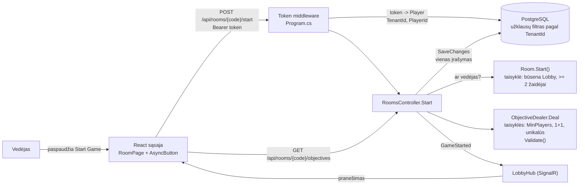

# Architektūros dokumentas

**Projektas**  BoardGameUtils – internetinė sistema stalo žaidimų žaidėjams. Žaidėjai susikuria žaidimo kambarį („Nemesis“), prisijungia prie jo su kodu ir slaptažodžiu, rašosi bendrame ir privačiame pokalbyje, o sistema kiekvienam žaidėjui slapta išdalija po du tikslus pagal žaidimo taisykles. Kiekvienas kambarys yra atskiras klientas (organizacija).

## Projektavimas galutinėje sistemoje

**Naudotojo veiksmas**  Kambario vedėjas paspaudžia **Start Game**. Įvestis – kambario kodas URL adrese ir vedėjo prieigos raktas (`Authorization: Bearer <token>`). Sistema patikrina, ar kreipiasi vedėjas ir ar kambarys dar laukimo būsenos, kiekvienam žaidėjui išdalija po vieną kooperatyvinį ir vieną savanaudišką tikslą, juos išsaugo ir per SignalR praneša visiems kambario žaidėjams. Kiekvienas žaidėjas savo naršyklėje mato tik savo du tikslus ir gali pasirinkti vieną.

Pavyzdys: kambaryje 4 žaidėjai. Tinkami tik tikslai, kurių `MinPlayers <= 4`, todėl K7 ir S5 niekam nepaskiriami. Rezultatas – 8 skirtingi tikslai, po 1 kooperatyvinį ir 1 savanaudišką kiekvienam žaidėjui.

### Sistemos schema



| Komponentas schemoje | Atsakomybė šiame scenarijuje | Vieta galutiniame kode |
| --- | --- | --- |
| React sąsaja | Siunčia užklausą su raktu iš `sessionStorage`; mygtukas išjungiamas, kol užklausa vykdoma, kad nebūtų dvigubo paleidimo; gavusi `GameStarted` įkelia savo tikslus | [RoomPage.tsx](../BoardgameUtils/client/src/RoomPage.tsx), [AsyncButton.tsx](../BoardgameUtils/client/src/components/AsyncButton.tsx), [roomsApi.ts](../BoardgameUtils/client/src/requests/roomsApi.ts) |
| Token middleware | Pagal raktą randa žaidėją duomenų bazėje ir užklausai nustato `TenantId` ir `PlayerId` | [Program.cs:117](../BoardgameUtils/server/Program.cs#L117), `TenantContext` – [Program.cs:12](../BoardgameUtils/server/Program.cs#L12) |
| RoomsController.Start | Įkelia kambarį (tik savo kliento), patikrina vedėjo rolę, kviečia taisykles, išsaugo, praneša | [RoomsController.cs:183](../BoardgameUtils/server/Controllers/RoomsController.cs#L183) |
| Room.Start | Taisyklė: žaidimą galima pradėti tik vieną kartą ir tik su bent 2 žaidėjais | [Room.cs:78](../BoardgameUtils/server/Models/Room.cs#L78) |
| ObjectiveDealer.Deal | Pagrindinis modulis: atrenka tinkamus tikslus, sumaišo, kiekvienam žaidėjui duoda 1 kooperatyvinį ir 1 savanaudišką, galiausiai patikrina rezultatą `Validate` | [ObjectiveDealer.cs:5](../BoardgameUtils/server/Services/ObjectiveDealer.cs#L5), [ObjectiveDealer.cs:64](../BoardgameUtils/server/Services/ObjectiveDealer.cs#L64) |
| AppDbContext | Kiekvienai užklausai automatiškai taiko filtrą `TenantId == prisijungusio žaidėjo TenantId` | [AppDbContext.cs](../BoardgameUtils/server/Data/AppDbContext.cs) |
| LobbyHub | Laiko SignalR grupes ir perduoda pranešimus `GameStarted`, `PlayersChanged`, `ChatChanged` | [LobbyHub.cs](../BoardgameUtils/server/Hubs/LobbyHub.cs) |
| PostgreSQL | Saugo kambarius, žaidėjus, tikslus ir žinutes | [compose.yaml](../BoardgameUtils/compose.yaml) |

**Pasirinkimas ir jo pagrindimas**  Taisyklės laikomos toje klasėje, kuriai priklauso duomenys, o kontroleris tik įkelia duomenis, kviečia metodą, išsaugo ir grąžina atsakymą.

- `Room` būsenos savybės (`State`, `Players`, `MaxPlayers`, `Password`) turi `private set`, o keičiamos tik metodais `Start()`, `AddPlayer()`, `AddMessage()`, `RevealObjectives()`, kurie tikrina taisykles ([Room.cs](../BoardgameUtils/server/Models/Room.cs)). Kambarys kuriamas tik per `Room.Create`, nes konstruktorius privatus – todėl neįmanoma sukurti kambario be patikrų.
- Tikslo pasirinkimas – `Player.ChooseObjective` ([Player.cs:32](../BoardgameUtils/server/Models/Player.cs#L32)), vardo patikra – `Player` konstruktoriuje.
- `ObjectiveDealer.Deal(room, catalog)` gauna tikslų katalogą kaip parametrą (numatytas – „Nemesis“ katalogas). Tai priklausomybės perdavimas: testas gali paduoti sumažintą katalogą (I etapo „klaidos“ scenarijus), o kitam žaidimui pakaktų kito katalogo, nekeičiant dalijimo logikos.
- Visos taisyklių klaidos yra `InvalidOperationException`, todėl kontroleris jas vienodai paverčia naudotojui rodomu pranešimu.

Kokią problemą tai išsprendė: anksčiau dalis patikrų buvo kontroleryje (pvz., vardo patikra, tikslo pasirinkimas), todėl tą pačią taisyklę reikėjo kartoti keliose vietose ir ją buvo galima apeiti tiesiog priskiriant savybę. Dabar taisyklę reikia keisti vienoje vietoje, ir ją galima testuoti be duomenų bazės ar HTTP (testai tiesiogiai kviečia `Room` ir `ObjectiveDealer`). Tai atitinka vienos atsakomybės principą (SRP): kontroleris atsako už HTTP, modelis – už žaidimo taisykles.

**Nedidelis pakeitimas ir testas**  Tarkime, žaidimą reikia leisti pradėti tik su bent 3 žaidėjais. Pakeisčiau vieną konstantą `MinPlayerCount` iš 2 į 3 ([Room.cs:5](../BoardgameUtils/server/Models/Room.cs#L5)); ją naudoja ir `Start()`, ir `Create()`, todėl kito kodo keisti nereikia. Testas: kambarys su 2 žaidėjais – `room.Start()` meta `InvalidOperationException` su pranešimu „Not enough players.“, o `room.State` lieka `Lobby`; kambarys su 3 žaidėjais – `room.State` tampa `Playing`, o `ObjectiveDealer.Deal(room)` grąžina 6 tikslus.

Per gynimą paleidžiami II etapo testai (`npm test`, aplankas `BoardgameUtils`). Su šiuo sprendimu susiję:
- `Deal_ManyTimes_EachGetsOneCoopAndOneSelfish_AllDistinct_AllAllowed` ([ObjectiveDealerTests.cs:67](../BoardgameUtils/Server.Tests/ObjectiveDealerTests.cs#L67)) – dalijimo taisyklės galioja 2–5 žaidėjams;
- `Deal_NotEnoughSelfishObjectives_Throws_AndAssignsNothing` ([ObjectiveDealerTests.cs:102](../BoardgameUtils/Server.Tests/ObjectiveDealerTests.cs#L102)) – su sumažintu katalogu niekas nepaskiriama ir grąžinama aiški klaida;
- `AddPlayer_AfterGameStarted_IsRejected` ([ObjectiveDealerTests.cs:90](../BoardgameUtils/Server.Tests/ObjectiveDealerTests.cs#L90)) – `Room` taisyklė neleidžia prisijungti prasidėjus žaidimui.

## Pagrindinis kokybės atributas

**Atributas ir įgyvendintas sprendimas**  Patikimumas. Žaidimas sugadinamas, jei du žaidėjai gauna tą patį tikslą, jei žaidėjas gauna netinkamo tipo tikslų arba tikslą, kuris turi prasmę tik didesniam žaidėjų skaičiui. Sprendimas ([ObjectiveDealer.cs](../BoardgameUtils/server/Services/ObjectiveDealer.cs)):

1. Atrenkami tik tikslai, kurių `MinPlayers` neviršija žaidėjų skaičiaus.
2. Kooperatyviniai ir savanaudiški tikslai atskirai sumaišomi; kiekvienas žaidėjas gauna `i`-ąjį kiekvieno sąrašo elementą, todėl tas pats tikslas negali būti išdalintas dukart.
3. Jei kurio nors tipo tikslų per mažai, prieš paskirstant metama klaida su konkrečiais skaičiais, pvz., „Not enough selfish objectives: need 3, have 2“.
4. Išdalijus tikslus, `Validate` dar kartą nepriklausomai patikrina visas tris taisykles. Tai apsauga, jei dalijimo logika ateityje būtų pakeista su klaida.
5. `Start` tikslus išsaugo vienu `SaveChanges` tik po sėkmingo dalijimo, todėl klaidos atveju duomenų bazėje neatsiranda dalinio paskirstymo, o kambarys lieka `Lobby` būsenos ir vedėjas gali bandyti iš naujo.
6. Dvigubą paleidimą stabdo `Room.Start()` būsenos patikra, o sąsajoje – mygtukas, išjungiamas kol užklausa vykdoma.

**Pakartojamas bandymas**  Aplinka: .NET 10 SDK, duomenų bazė nereikalinga (testai kviečia modulį tiesiogiai). Iš aplanko `BoardgameUtils` paleidžiama `npm test` (arba `dotnet test Server.Tests --logger "console;verbosity=normal"`, kad matytųsi kiekvieno testo rezultatas). Bandymo sąlygos: naudojamas tikras 14 tikslų „Nemesis“ katalogas; kiekvienam žaidėjų skaičiui 2, 3, 4 ir 5 tikslai dalijami po 1000 kartų ir kiekvienas dalijimas tikrinamas. Klaidos atvejui – 3 žaidėjai ir sumažintas katalogas (K1–K7, S6, S7). Paskutinio paleidimo išvestis: [reliability-results.txt](reliability-results.txt).

| Sėkmės kriterijus | Faktinis rezultatas | Išvada ir įrodymas |
| --- | --- | --- |
| Kiekvienas žaidėjas gauna tiksliai 1 kooperatyvinį ir 1 savanaudišką tikslą, visi tikslai skirtingi, nė vienas nereikalauja daugiau žaidėjų, nei yra kambaryje – visuose dalijimuose | 4000 dalijimų (po 1000 su 2, 3, 4 ir 5 žaidėjais), visi atitiko visas tris taisykles | Tikslas pasiektas. Testas `Deal_ManyTimes_...`, išvestis [reliability-results.txt](reliability-results.txt) |
| Kai tikslų nepakanka, niekam nieko nepaskiriama ir pranešama, ko trūksta | Gauta klaida „Not enough selfish objectives: need 3, have 2“, nė vienam žaidėjui nepaskirtas joks tikslas, kambarys liko `Lobby` | Tikslas pasiektas. Testas `Deal_NotEnoughSelfishObjectives_Throws_AndAssignsNothing` |

## SaaS veikimas ir paleidimas

**Prisijungimas ir klientų izoliacija**  Kiekvienas kambarys yra atskiras klientas (`Tenant`). Sukūrus kambarį ar prisijungus prie jo, serveris žaidėjui sugeneruoja atsitiktinį 64 simbolių raktą ([Player.cs](../BoardgameUtils/server/Models/Player.cs)). Kiekvienoje užklausoje middleware ([Program.cs:117](../BoardgameUtils/server/Program.cs#L117)) pagal raktą randa žaidėją ir nustato jo `TenantId`. `AppDbContext` visoms lentelėms (`Rooms`, `Players`, `PlayerObjectives`, `ChatMessages`) taiko užklausų filtrą `TenantId == prisijungusio žaidėjo TenantId`, todėl kito kliento įrašai užklausai tiesiog neegzistuoja. Kai A kambario žaidėjas su savo raktu užklausoje nurodė B kambario kodą: skaitymas (`GET /api/rooms/BBBBBB/getPlayerInfo`) ir keitimas (`POST /api/rooms/BBBBBB/messages`, `POST /api/rooms/BBBBBB/start`) grąžino „Room not found“, o B kambario duomenys nepasikeitė. Be rakto ar su neteisingu raktu – tas pats rezultatas. Žingsniai – [README](../README.md), skyrius „Isolation between organisations“; automatinis testas `TenantA_CannotSee_TenantB_Room`. Kambario viduje privačias žinutes mato tik siuntėjas ir gavėjas ([RoomsController.cs:379](../BoardgameUtils/server/Controllers/RoomsController.cs#L379)).

**Rolės**  Dvi rolės: kambario vedėjas (`IsLobbyLeader`) ir žaidėjas. Veiksmas – žaidimo pradėjimas. Serveris tikrina rolę [RoomsController.cs:199](../BoardgameUtils/server/Controllers/RoomsController.cs#L199) (taip pat tikslų atskleidimui – [RoomsController.cs:240](../BoardgameUtils/server/Controllers/RoomsController.cs#L240)). Su vedėjo raktu `POST /api/rooms/{code}/start` grąžina sėkmę ir išdalija tikslus; su paprasto žaidėjo raktu – „Only the lobby leader can start the game“, ir niekas nepasikeičia. Rolė nustatoma serveryje pagal raktą, ne pagal kliento siunčiamus duomenis.

**Kliento konfigūracija**  Kiekvienas kambarys turi savo nustatymą – didžiausią žaidėjų skaičių (`MaxPlayers`, 2–5), kurį vedėjas pasirenka kurdamas kambarį ir kuris saugomas to kambario įraše. Bandymas: sukuriamas kambarys A su `MaxPlayers = 2` ir kambarys B su `MaxPlayers = 5`, į kiekvieną bando prisijungti dar du žaidėjai. A: pirmas prisijungia, antram grąžinama „Room is full“ ([Room.cs:33](../BoardgameUtils/server/Models/Room.cs#L33)). B: abu prisijungia. Tas pats veiksmas tame pačiame serveryje elgiasi skirtingai, nes taisyklė skaito kiekvieno kambario nustatymą, o ne bendrą konfigūraciją.

**API užklausa**  Pavyzdys – `POST /api/rooms/{code}/start`. Viskas, ko reikia, gaunama iš pačios užklausos ir duomenų bazės: kas kreipiasi – iš `Authorization` rakto, ieškant žaidėjo duomenų bazėje; koks kambarys, jo būsena ir žaidėjai – iš PostgreSQL; rezultatas iškart įrašomas į PostgreSQL. `TenantContext` ir `AppDbContext` kuriami kiekvienai užklausai iš naujo (`AddScoped`), serverio atmintyje tarp užklausų nieko nelaikoma, todėl tą pačią užklausą galėtų aptarnauti ir kitas serverio procesas. Išimtys, kurios nekeičia duomenų: SignalR grupės (tik pranešimai „kažkas pasikeitė“ – po jų klientas pats atsisiunčia duomenis per API) ir prisijungimų dažnio ribotuvas laikomi proceso atmintyje; keliems procesams SignalR reikėtų bendro „backplane“ (pvz., Redis).

**Vietinis paleidimas**  Po pradinio paruošimo (iš aplanko `BoardgameUtils` – `cp .env.example .env` ir `.env` faile nustatyti `POSTGRES_PASSWORD`, aprašyta [README](../README.md) skyriuje „Run in Docker“) sistema paleidžiama viena komanda:

```
docker compose up --build
```

[compose.yaml](../BoardgameUtils/compose.yaml) iš `.env` perduoda: `POSTGRES_USER` ir `POSTGRES_PASSWORD` – duomenų bazei ir serveriui (kaip `ConnectionStrings__Default`), `CLIENT_ORIGIN` – serveriui (`ClientOrigin`, leidžiamas CORS adresas), `API_URL` – klientui kaip `VITE_API_URL` jo surinkimo metu. Serveris paleidžiamas tik kai duomenų bazė sveika (`healthcheck`), o paleidžiamas pats pritaiko migracijas ir įrašo pavyzdinius duomenis.

## Architektūros dokumentas ir AI

### Kas pasikeitė nuo I etapo ir kodėl

**Pradinis projektas**  [I etapo dokumentas](../1-etapo-pateikimo-sablonas%20uni.pdf).

| I etapo planas | Galutinis sprendimas | Pakeitimo priežastis ir pasekmė |
| --- | --- | --- |
| Paskyrų kūrimas neįeina į apimtį, klientų atskyrimas neaprašytas | Kiekvienas kambarys – atskiras klientas (`Tenant`), prisijungiama su kambario kodu ir slaptažodžiu, kiekvienas žaidėjas gauna raktą | III etapas reikalauja kelių klientų izoliacijos. Raktas be paskyrų išlaikė I etapo apimtį, o izoliacija įgyvendinta vienoje vietoje (užklausų filtrai) |
| SignalR – gyvam susirašinėjimui | Visi veiksmai (žinutės, pradėjimas, pasirinkimas) – per REST API; SignalR tik praneša „pasikeitė“ | Taip API tampa be būsenos (duomenys tik PostgreSQL), lengviau tikrinti teises ir testuoti. Pasekmė – po pranešimo klientas daro papildomą užklausą |
| Vedėjas atskirai pradeda tikslų pasirinkimo etapą | Žaidėjai renkasi iškart po dalijimo; vedėjas vietoje to gali „atskleisti“ visų pasirinktus tikslus | Atskiras etapas žaidėjams nieko nedavė; atskleidimas naudingesnis žaidimo pabaigoje |
| Patikimumas: prieš paskiriant tikrinti, ar tikslas jau paskirtas ir ar tinka žaidėjų skaičiui | Atranka pagal `MinPlayers` ir maišymas užtikrina taisykles pagal konstrukciją; papildomai `Validate` po dalijimo ir 4000 dalijimų testas | Patikra po dalijimo paprastesnė ir aiškesnė nei patikra prieš kiekvieną paskyrimą; tikslas ir atributas nepakeisti |
| Klaidų pranešimai lietuviškai („Nepakanka savanaudiškų tikslų: reikia 3, yra 2“) | Tas pats pranešimas angliškai („Not enough selfish objectives: need 3, have 2“) | Visa sąsaja angliška |
| AI asistentas žaidimo taisyklėms (jei liks laiko) | Neįgyvendintas | Pasirinktas papildomas kriterijus – diegimas debesyje |
| Diegimas neplanuotas | Docker Compose vietiniam paleidimui ir diegimas Render debesyje | III etapo reikalavimai |

### AI panaudojimas

AI naudojau programuodamas ir rašydamas dokumentaciją. Su AI paruošiau projekto struktūrą ir gavau vieno API endpointo bei SignalR ryšio pavyzdį. Pagal juos dalį endpointų ir sąsajos parašiau pats, likusią dalį – su AI. Visą kodą peržiūrėjau ir jį suprantu, išskyrus CSS, kuris sugeneruotas AI.

| Įrankis ir užduotis | Kas sugeneruota ir panaudota | Ką atmetėte ar perrašėte ir kodėl | Kaip patikrinote |
| --- | --- | --- | --- |
| Claude Code – projekto palyginimas su III etapo reikalavimais | Trūkstamų dalių sąrašas | Atsisakiau atskiro kliento nustatymo keitimo endpointo – pakanka kuriant kambarį pasirenkamo `MaxPlayers` | Palyginau su reikalavimų lentele |
| Claude Code – patikimumo sprendimas | Aiškūs klaidų pranešimai su skaičiais, `Validate`, klaidos grąžinimas naudotojui vietoj 500 | Atmečiau `Version` (Postgres `xmin`) lygiagretumo žymą ir `catch ... when` konstrukciją – sunkiai paaiškinama; vietoj to vienas išimties tipas ir išjungiamas mygtukas | `npm test`, kodo peržiūra |
| Claude Code – testai | Esamas 4 žaidėjų testas paverstas 1000 dalijimų testu 2–5 žaidėjams | Atsisakiau atskiro `npm` skripto rezultatams – paliktas vienas `npm test` | Testai praeina, išvestis išsaugota |
| Claude Code – sąsaja | `AsyncButton`, `AsyncForm` komponentai prieš dvigubą siuntimą; būsenos atkūrimas perkrovus puslapį | Pirmą variantą su `useState` ir `try/catch` puslapyje pakeičiau bendru komponentu – švariau | `tsc`, rankinis bandymas naršyklėje |
| Claude Code – modelių suvienodinimas | Taisyklės perkeltos į `Player`/`Room`, `private set`, privatus `Room` konstruktorius | – | `npm test`, EF patikra, kad duomenų bazės modelis nepasikeitė |
| Claude Code – diegimas debesyje | Render nustatymų žingsniai, CORS ir `rewrite` klaidų diagnostika | – | Visas scenarijus atliktas debesyje |

**AI kaip sistemos funkcija**  Sistemoje AI nenaudojamas.

## Papildomų balų įrodymai

**Diegimas debesyje** – Sistema veikia Render platformoje: PostgreSQL (Render Postgres), serveris (Web Service iš [server/Dockerfile](../BoardgameUtils/server/Dockerfile), `https://boardgameutils.onrender.com`) ir klientas (Static Site, `https://boardgameutils-1.onrender.com`). Debesyje parodomas visas pagrindinis scenarijus: kambario sukūrimas, prisijungimas iš kitos naršyklės, pokalbis, žaidimo pradėjimas ir tikslų pasirinkimas. Konfigūracija per aplinkos kintamuosius: serveriui `ConnectionStrings__Default`, `ClientOrigin`, `PORT=8080`; klientui `VITE_API_URL`; klientui pridėta taisyklė `/*` → `/index.html` (Rewrite), kad veiktų tiesioginės nuorodos ir puslapio perkrovimas. Diegimo kartojimas: Render automatiškai perdiegia abi paslaugas po kiekvieno `push` į `main`; naujoje aplinkoje pakanka sukurti tas pačias tris paslaugas su minėtais kintamaisiais. Migracijos ir pavyzdiniai duomenys pritaikomi automatiškai paleidus serverį.
